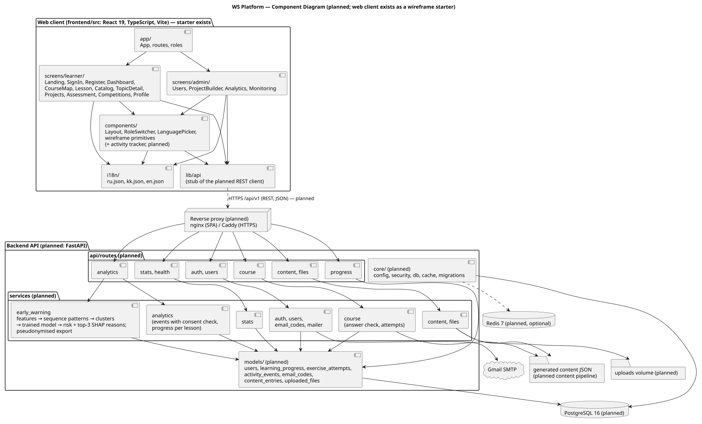

# WS Platform

**Development of a WorldSkills IT Software Solutions Training Platform with an Intelligent Competency
Diagnostics Module Based on Behavioral Log Analysis**

A web platform for learning C# and preparing for WorldSkills *IT Software Solutions for Business*
(Skill 09) in **Russian, Kazakh and English**. It combines a C# course with server-checked exercises,
past WorldSkills test projects with weighted marking criteria, and consent-based learning analytics that
**warn teachers early about learners at risk** of dropping out or failing a module test — with the reasons
behind every warning.

> Diploma project · Software Engineering · Astana IT University · 2026–2027

| | |
|---|---|
| **Repository** | [github.com/aleke88884/ws_platform_kz](https://github.com/aleke88884/ws_platform_kz) |
| **Task tracker** | [YouTrack project `WSP`](https://wsplatform.youtrack.cloud/projects/WSP) |
| **CI** | [GitHub Actions — frontend](https://github.com/aleke88884/ws_platform_kz/actions/workflows/frontend.yml) |
| **Pull requests** | [github.com/aleke88884/ws_platform_kz/pulls](https://github.com/aleke88884/ws_platform_kz/pulls?q=is%3Apr) |
| **Documentation** | [docs/](docs/README.md) · [diagrams/](diagrams/README.md) |

---

## Contents

- [Why](#why)
- [Expected outcomes](#expected-outcomes)
- [What the platform does](#what-the-platform-does)
- [Current status](#current-status)
- [Architecture](#architecture)
- [Tech stack](#tech-stack)
- [Getting started](#getting-started)
- [Repository structure](#repository-structure)
- [Documentation](#documentation)
- [How we work](#how-we-work)
- [Roadmap](#roadmap)
- [Team](#team)
- [License](#license)

## Why

Students preparing for WorldSkills competitions, and students learning C# on their own, spend most of their
practice time alone. A teacher or coach usually sees only the finished work — not where the student got
stuck, which topics took longest, or when they stopped coming back. By the time it is visible, the student
has often fallen behind or quit.

Among the platforms we reviewed ([existing systems comparison](docs/04-existing-systems.md)), we found none that
combines WorldSkills preparation material, a C# course with automatically checked exercises, and full
Kazakh-language support. WS Platform is built to close that gap and to give teachers an early, explainable signal.

## Expected outcomes

- A working multi-role web platform with a documented REST API.
- A C# course in Russian, Kazakh and English (8 modules, about 36 lessons in modules 1–5, at least three
  auto-checked exercises per lesson) plus training material based on published past WorldSkills test projects.
- An early-warning model with a report on F1, AUC and earliness against a baseline — reported honestly even if it
  does not beat the baseline.
- Documentation of requirements, design and tests, with test reports based only on real runs.

## What the platform does

| For | Capabilities |
|---|---|
| **Learner** (`student`) | C# course with exercises checked on the server · topic catalog with search · test projects with weighted criteria and self-assessment · past competition modules · own progress and diagnostics, synced across devices · interface and course in ru / kk / en |
| **Teacher / coach** (`expert`) | Test-project builder with file upload · **risk list** of learners with the reasons for each value |
| **Administrator** (`admin`) | Manage users and content · progress per lesson and per learner · pseudonymised research export |
| **Owner** (`superadmin`) | System monitoring · manage administrators |

Roles are ranked: each role can do everything the roles below it can, and can manage only users of a lower
role. Full permission matrix: [docs/06-requirements.md §2](docs/06-requirements.md).

### How early warning works

1. **While the learner studies**, the browser sends batched activity events (page views, active time,
   exercise attempts, self-assessment) to the backend — only with the learner's research consent.
2. **Analysis.** For each learner the backend builds features from the first days of activity (sessions,
   unanswered exercises, gaps between visits, action sequences). A gradient-boosting model turns them into a
   risk value; logistic regression is the baseline.
3. **For the teacher**, a ranked risk list with SHAP-based reasons for every learner.

The model is judged by **F1, AUC and earliness** against the baseline, on our data and on the public
[OULAD](https://analyse.kmi.open.ac.uk/open_dataset) dataset. If it does not beat the baseline, we report that
honestly and keep risk values hidden.

> **Principle:** the warning is a hint for the teacher, not a verdict about the student. Risk values are never
> used for grading, ranking results or team selection.

## Current status

**Stage: analysis and design (pre-defense 1, October 2026).** We keep this table honest — nothing below is
claimed as working unless there is recorded evidence.

| Part | State |
|---|---|
| Proposal, relevance evidence, interviews, literature review, existing systems, technology comparison | ✅ Done |
| Requirements specification (FR / NFR with acceptance criteria, MoSCoW) | ✅ Done |
| Architecture with five PlantUML diagrams | ✅ Done |
| Verification plan, project management and risks | ✅ Done |
| Frontend **clickable wireframe**: 16 routes, scenarios P1–P11, role switcher, ru / kk / en | ✅ Done |
| CI: i18n and route checks + type check and build on every PR | ✅ Done ([recorded run](docs/verification/frontend-test-2026-10-23.txt): 6 / 6 pass) |
| Backend (FastAPI), database, course content | ⏳ Planned — starts after supervisor review of requirements and architecture |
| Activity tracking, early-warning model, deployment | ⏳ Planned |

The frontend is a wireframe: grey blocks describe what each screen will show; there is no real data and no
backend yet.

## Architecture



- **Web client** — React SPA (exists as a wireframe) talking to a REST API under `/api/v1`.
- **Reverse proxy** — HTTPS termination (Caddy), static files, `/api` → backend.
- **Backend** — FastAPI: auth and roles, course and answer checking, progress sync with version conflicts
  (`409`), content, analytics, early warning, exports.
- **Storage** — PostgreSQL, optional Redis-compatible cache, a volume for task files.
- **External** — Gmail SMTP for one-time registration / reset codes; OULAD used offline for evaluation.

More diagrams — system context, use cases, data model (ER), diagnostics sequence — in
[docs/07-architecture.md](docs/07-architecture.md).

## Tech stack

| Part | Choice | Status |
|---|---|---|
| Frontend | React 19, TypeScript, Vite, React Router | in use |
| Backend | Python 3.11+, FastAPI, SQLAlchemy 2, Alembic | planned |
| Database | PostgreSQL (SQLite for tests) | planned |
| Cache | Redis-compatible, optional (Valkey as alternative) | planned |
| Machine learning | Gradient boosting, sequence clustering, SHAP; logistic regression baseline | planned |
| Deployment | Docker Compose, Caddy (HTTPS) | planned |
| CI | GitHub Actions | in use |
| Diagrams | PlantUML | in use |

Every choice is compared with 2–3 alternatives in [docs/05-technology-comparison.md](docs/05-technology-comparison.md).

## Getting started

**Requirements:** Node.js **20.19+** (CI uses Node 22) and npm.

```bash
git clone https://github.com/aleke88884/ws_platform_kz.git
cd ws_platform_kz/frontend
npm install
npm run dev        # http://localhost:5173
```

| Command (in `frontend/`) | What it does |
|---|---|
| `npm run dev` | Dev server on port 5173; `/api` is proxied to `http://localhost:8000` (for the future backend) |
| `npm test` | Checks that ru / kk / en dictionaries have identical keys and every route has an existing screen and a role |
| `npm run build` | Type check (`tsc -b`) and production build into `dist/` |
| `npm run preview` | Serves the production build locally |

**Configuration.** Copy `frontend/.env.example` to `frontend/.env` if you need to change `VITE_API_URL`
(default `/api/v1`). Real values live only in `.env` files, never in the repository — see
[config/README.md](config/README.md).

### Exploring the prototype

Use the **role switcher** in the header to see the menu of each role and the **language picker** to switch
between Russian, Kazakh and English.

| Route | Screen | Role | Scenario |
|---|---|---|---|
| `/welcome`, `/sign-in`, `/register` | Landing, sign-in, registration | public | P1, P2 |
| `/` | Dashboard | student | P7 |
| `/course`, `/lesson/:id` | Course map, lesson | student | P3 |
| `/topics`, `/topic/:id` | Topic catalog, topic | student | P4 |
| `/projects`, `/project/:id/assessment` | Test projects, self-assessment | student | P5 |
| `/competitions` | Past competition modules | student | P6 |
| `/profile` | Profile and consent | student | P7 |
| `/admin/builder` | Test-project builder | expert | P9 |
| `/admin/users`, `/admin/analytics` | Users, analytics | admin | P8, P10 |
| `/admin/monitoring` | Monitoring | superadmin | P11 |

The full route table is [`frontend/src/app/routes.json`](frontend/src/app/routes.json).

## Repository structure

```text
ws_platform_kz/
├── frontend/              React + TypeScript wireframe prototype
│   ├── src/app/           router, route table, roles, role context
│   ├── src/screens/       learner/ and admin/ screens
│   ├── src/components/    Layout, RoleSwitcher, LanguagePicker, wireframe primitives
│   ├── src/i18n/          ru.json, kk.json, en.json
│   ├── src/lib/api.ts     stub of the REST client for /api/v1
│   └── tests/             i18n and route-table checks (node --test)
├── backend/               planned FastAPI service (structure in its README)
├── docs/                  proposal, requirements, architecture, verification, PM, interviews
│   └── verification/      raw outputs of real check runs
├── diagrams/
│   ├── src/               PlantUML sources (editable)
│   └── export/            SVG and PNG exports
├── config/                configuration reference
└── .github/workflows/     CI: frontend tests and build
```

## Documentation

| # | Document | What it covers |
|---|---|---|
| 1 | [Project proposal](docs/01-proposal.md) | Problem, aim, objectives, scope |
| 2 | [Evidence of relevance](docs/02-relevance-evidence.md) · [interviews](docs/interviews/interview-questions.md) | What is verified vs assumed |
| 3 | [Literature review](docs/03-literature-review.md) | Learning analytics, dropout prediction, explainability |
| 4 | [Existing systems](docs/04-existing-systems.md) | Comparison against criteria C1–C10 |
| 5 | [Technology comparison](docs/05-technology-comparison.md) | Justified technology choices |
| 6 | [Requirements](docs/06-requirements.md) | FR / NFR, priorities, acceptance criteria |
| 7 | [Architecture](docs/07-architecture.md) · [diagrams](diagrams/README.md) | Context, use cases, components, data model, sequence |
| 9 | [Verification plan](docs/09-verification-plan.md) · [recorded runs](docs/verification/README.md) | Test levels, ML evaluation protocol |
| 10 | [Project management and risks](docs/10-project-management.md) | Milestones, risks, dependencies, next steps |

## How we work

**Task tracker:** [YouTrack project `WSP`](https://wsplatform.youtrack.cloud/projects/WSP)

Every change is traceable from task to evidence:

```text
YouTrack task WSP-<n> → branch WSP-<n>-short-name → commits "WSP-<n>: …" → pull request → CI → main
```

1. Create or take a task in the YouTrack project `WSP`.
2. Branch from `main`: `git checkout -b WSP-42-short-name`.
3. Start every commit message with the task ID: `WSP-42: add catalog search`.
4. Open a pull request into `main`. CI must pass and **another team member** reviews it.
5. Name the requirement IDs (e.g. `FR-03`) the PR addresses and update affected documents in the same PR.
6. Save outputs of real check runs in [`docs/verification/`](docs/verification/README.md) with date, commit
   and tool versions.

Full definition of done: [docs/10-project-management.md §3.4](docs/10-project-management.md).

## Roadmap

| Milestone | Content | Status |
|---|---|---|
| M0 | Repository, workflow, frontend wireframe, CI | ✅ Done |
| M1 | Pre-defense 1 documentation package | ✅ Done |
| M2 | Supervisor review of requirements and architecture | 🔄 In progress — until agreement is recorded before backend work |
| M3 | Backend foundation: FastAPI, migrations, sign-in, roles, user management, registration codes, backend CI | ⏳ |
| M4 | Learning core: course and exercises, catalog, test projects, competition modules, progress sync | ⏳ |
| M5 | Activity tracking, consent, research export, data retention | ⏳ |
| M6 | Deployment (Docker Compose + Caddy), load and security tests, usability study | ⏳ |
| M7 | Ethics approval and data collection | ⏳ |
| M8 | Early-warning model and evaluation against the baseline (incl. OULAD) | ⏳ |
| M9 | Final verification and defense | ⏳ |

## Team

| Member | Role |
|---|---|
| **Rysbek Alnur** | Team lead · backend and machine learning |
| **Zhumash Adilzhan** | Frontend and UX |
| **Mussilimov Zhangir** | DevOps and testing |
| **Symbat Nurgaliyeva**, PhD | Supervisor · Assistant Professor, Astana IT University |

## License

No license has been chosen yet; until one is added, all rights are reserved by the authors. Choosing a
license is tracked in [docs/10-project-management.md §8](docs/10-project-management.md).
