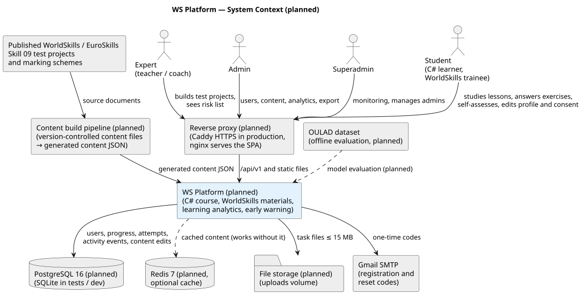
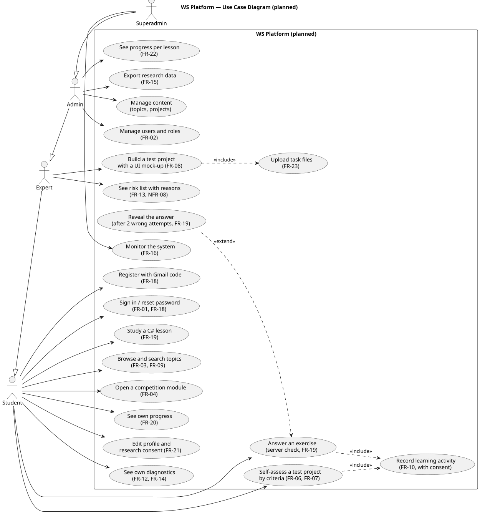
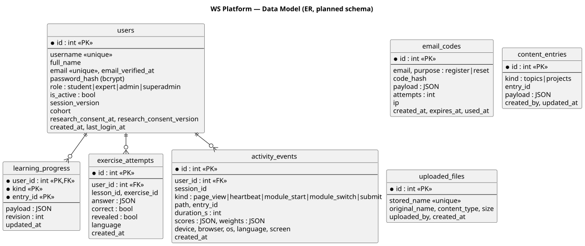
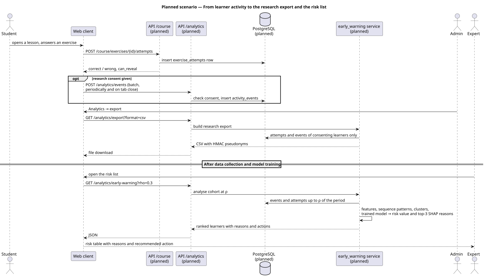

# 7. Architecture and Diagrams

**Status: planned architecture.** This chapter describes the architecture the team will build. The only
part that exists in the repository today is the **frontend starter**: a clickable wireframe of the key
screens (React 19 + TypeScript + Vite + react-router) in [`frontend/`](../frontend/). It has ru / kk / en
interface labels, a role switcher to preview what each role sees, and a stub of the planned REST client.
The backend, database, content pipeline and analytics are **not built yet**; their planned structure is
in [`backend/README.md`](../backend/README.md).

Editable sources: [`diagrams/src/*.puml`](../diagrams/src) (PlantUML). How to render them:
[diagrams/README.md](../diagrams/README.md).

Readable exports (SVG and PNG) are in [`diagrams/export/`](../diagrams/export). They were rendered from the
sources with PlantUML 1.2024.7; every source rendered without errors. Re-render after editing a source
(commands in [diagrams/README.md](../diagrams/README.md)).

## 7.1 System context
Source: [01-system-context.puml](../diagrams/src/01-system-context.puml) · export: [SVG](../diagrams/export/system-context.svg), [PNG](../diagrams/export/system-context.png)

Four roles (student, expert, admin, superadmin) are to use the platform through a reverse proxy. The
planned platform stores its data in PostgreSQL, uses Redis as an optional cache and a volume for task
files, and sends one-time registration and reset codes through Gmail SMTP. Content (the C# course,
topics, test projects, competition modules) is to be built from version-controlled files by a planned
content pipeline; the published WorldSkills/EuroSkills Skill 09 test projects (WSC2017–2024, ES2025)
and their marking schemes are its source material. OULAD is to be used only offline, for model
evaluation. Every box except the users is planned.

## 7.2 Use cases
Source: [02-use-case.puml](../diagrams/src/02-use-case.puml) · export: [SVG](../diagrams/export/use-case.svg), [PNG](../diagrams/export/use-case.png)

The diagram shows the planned use cases of the four roles, each labelled with its requirement ID from
[06-requirements.md](06-requirements.md). A higher role inherits the use cases of the lower ones. Every
Must requirement has a use case. The wireframe prototype already shows the screens for these use cases
(scenarios P1–P11 in [prototype/README.md](prototype/README.md)), but none of them works end to end yet.

## 7.3 Components
Source: [03-component.puml](../diagrams/src/03-component.puml) · export: [SVG](../diagrams/export/component.svg), [PNG](../diagrams/export/component.png)

The diagram has two parts: the web client, whose structure matches the existing frontend starter, and
the planned proxy, backend and storage.

| Layer | Description | Status |
|---|---|---|
| Web client: app shell | `frontend/src/app/`: `App`, the route table and the role definitions | exists (starter) |
| Web client: screens | `frontend/src/screens/learner/` (Landing, SignIn, Register, Dashboard, CourseMap, Lesson, Catalog, TopicDetail, Projects, Assessment, Competitions, Profile) and `frontend/src/screens/admin/` (Users, ProjectBuilder, Analytics, Monitoring). Today they are wireframes with placeholder data | exists as wireframes; behaviour planned |
| Web client: components | `frontend/src/components/`: Layout, RoleSwitcher, LanguagePicker and wireframe primitives. A planned activity tracker will send events only after research consent, in batches | exists (starter); activity tracker planned |
| Web client: i18n | `frontend/src/i18n/`: `ru.json`, `kk.json`, `en.json` interface dictionaries | exists (starter) |
| Web client: API client | `frontend/src/lib/api.ts`: a stub of the planned REST client (`/api/v1`, JSON). It does not call a server yet | stub; real calls planned |
| Proxy | nginx to serve the SPA and proxy `/api`; Caddy to terminate HTTPS in production | planned |
| Backend | FastAPI modular monolith: `api/routes` → `services` → `models`, with migrations applied at start-up (NFR-14) | planned |
| Course | planned `services/course`: lessons from content files, answers checked on the server, every attempt stored (FR-19) | planned |
| Registration | planned `services/email_codes` and `services/mailer`: hashed one-time codes with attempt and rate limits, sent through Gmail SMTP (FR-18) | planned |
| Learning analytics | planned `services/analytics`: event ingestion with a server-side consent check, progress per lesson, retention purge (FR-10, FR-22, NFR-09) | planned |
| Early warning | planned `services/early_warning`: window at ρ → aggregate and criterion features → sequence patterns → clusters → trained model → risk value with top-3 SHAP reasons; also the pseudonymised research export (FR-11–FR-15) | planned |
| Storage | PostgreSQL 16 (SQLite in tests), optional Redis cache, uploads volume, generated content JSON | planned |

**Key decisions (ADR summary, planned)**
1. Modular monolith instead of microservices: a three-person team and one deployable unit. A code runner
   for learners' programs, if it is ever built, will be a separate sandboxed service.
2. Activity data in the main database (`activity_events`, `exercise_attempts`), indexed by user and time.
3. Privacy by design: the client sends telemetry only after consent, and the ingestion endpoint
   re-checks consent on the server; consent is stored with its text version; exports include only
   consenting learners, with HMAC pseudonyms; a retention limit for activity events (NFR-09).
4. Answers are checked on the server, so they are never sent to the browser before an attempt (FR-19).
5. Content comes from version-controlled files, plus database overrides edited in the admin panel
   (FR-08).
6. The frontend is built first as a wireframe, so the screens and roles can be reviewed before the API
   exists; `lib/api.ts` fixes the planned endpoint names in one place.

## 7.4 Data model (planned schema)
Source: [04-data-model.puml](../diagrams/src/04-data-model.puml) · export: [SVG](../diagrams/export/data-model.svg), [PNG](../diagrams/export/data-model.png)

No database exists yet. The ER diagram is the planned schema:

| Table | Purpose | Requirements |
|---|---|---|
| `users` | account, role, Gmail address and verification time, password hash, cohort, research-consent time and consent-text version | FR-01, FR-02, FR-18, FR-21 |
| `email_codes` | hashed one-time codes for registration and password reset, with attempt count and expiry | FR-18 |
| `learning_progress` | per-user progress records with a revision number, so stale writes can be refused | FR-06, FR-20 |
| `exercise_attempts` | every answer to a course exercise: correctness, revealed flag, language, time | FR-10, FR-19, FR-22 |
| `activity_events` | consented browser events: page view, heartbeat, module navigation, self-assessment submit with score and weight vectors | FR-10, NFR-09 |
| `content_entries` | topics and test projects edited in the admin panel | FR-08 |
| `uploaded_files` | task files attached to projects (≤ 15 MB each) | FR-23 |

## 7.5 Key scenario: learner activity → research export → risk list (planned)
Source: [05-diagnostics-sequence.puml](../diagrams/src/05-diagnostics-sequence.puml) · export: [SVG](../diagrams/export/diagnostics-sequence.svg), [PNG](../diagrams/export/diagnostics-sequence.png)

The sequence diagram shows a planned scenario. A student answers an exercise and the attempt is stored on
the server. If the student gave research consent, the web client also sends activity events in batches,
and the server re-checks consent before storing them. An admin downloads a pseudonymised export that
contains only consenting learners. After data collection and model training, an expert opens the risk
list: the early-warning service builds features from activity up to ρ, applies the trained model and
returns learners ranked by risk, each with the top-3 reasons and a recommended action.

## 7.6 Traceability: requirements → planned components
The full matrix with verification methods is in [06-requirements.md](06-requirements.md). All backend
components below are planned; the screens exist as wireframes in `frontend/src/screens/`.

| Requirement | Component(s) | Data | Use case |
|---|---|---|---|
| FR-01, FR-02, FR-18 | auth, users, email_codes, mailer; SignIn, Register, admin/Users screens | users, email_codes | Register, Sign in, Manage users |
| FR-03, FR-04 | content service; Catalog, TopicDetail, Competitions screens | content JSON, content_entries | Browse topics, Open competition module |
| FR-06, FR-07 | progress route; Projects, Assessment screens | learning_progress | Self-assess |
| FR-08, FR-23 | admin/ProjectBuilder screen, files service | content_entries, uploaded_files | Build test project, Upload files |
| FR-09 | `frontend/src/i18n/`, LanguagePicker; translated course content | content JSON | all |
| FR-10 | activity tracker (planned component), analytics ingestion | activity_events, exercise_attempts | Record learning activity |
| FR-11–FR-14 | early_warning service; admin/Analytics screen (risk list), Profile screen (own diagnostics) | activity_events, exercise_attempts | See risk list, See own diagnostics |
| FR-15, FR-21 | early_warning export; Profile screen | users (consent), exercise_attempts, activity_events | Export research data, Edit consent |
| FR-16 | stats service; admin/Monitoring screen | all | Monitor |
| FR-19, FR-20, FR-22 | course service; CourseMap, Lesson, Dashboard, admin/Analytics screens | exercise_attempts, learning_progress | Study lesson, Answer exercise, See progress |
